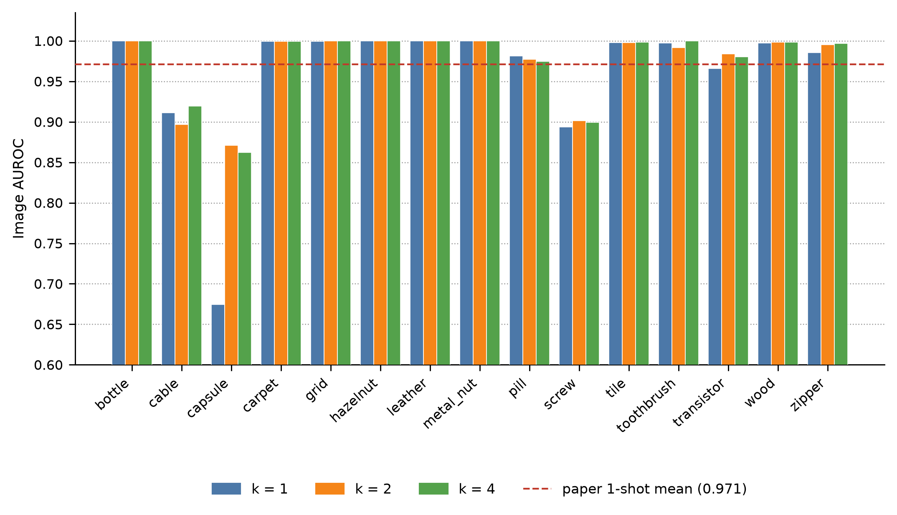
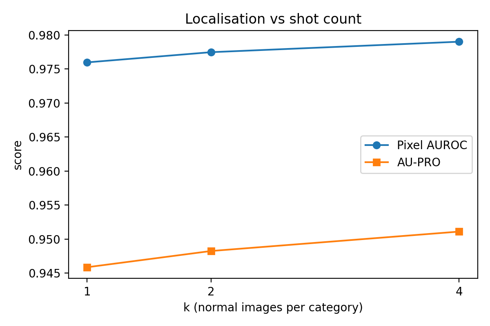
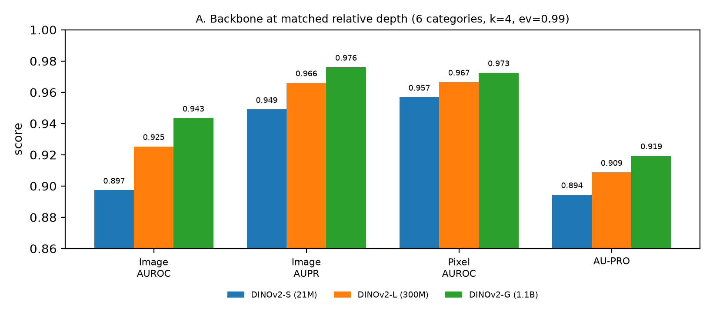
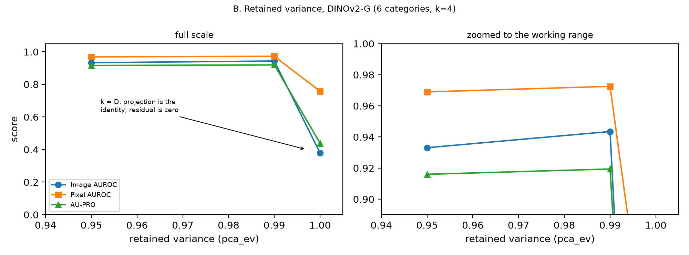
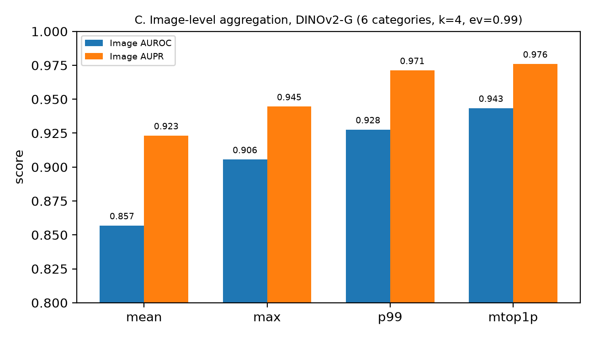

## 1. How I Asked AI Tools to Find the Algorithm

### 1.1 Reading the brief before searching

The Assignment #3 brief asks for a recent PCA or LDA algorithm applied to computer vision and pattern recognition, with an AI doing the searching, the programming and the writing. Three things in it shaped everything that followed:

- the algorithm must be recent, which is a moving target and had to be pinned to a concrete year range before any search could be judged;
- the report needs six specific parts, including how the AI found the algorithm, which is why the search was logged as it happened rather than reconstructed afterwards; and
- "You are NOT allowed to write any code by yourself!" — so every line in the submitted notebooks came from the AI, and my job was to run it, verify it and judge it.

I added two constraints of my own, both of which bound harder than the brief itself:

| My constraint | Why it matters |
|---|---|
| Must run on the free tier of Google Colab (T4, 16 GB) | Excludes anything dominated by training a large backbone |
| Must have author-released code | Without it, getting a number means reimplementing from the paper, which the brief forbids |

### 1.2 The prompts I used

I typed the prompts in Chinese, which is the language I think in; the report is in English. The opening prompt, verbatim:

> AI Assignment #3
> CISC3024 Pattern Recognition
> November, 2026
> AI Assignment # 3 aims to find a recent PCA/LDA algorithm with application to computer vision and pattern recognition. You are expected to use an AI tool or agent to do everything for you, including, but not limited to, algorithm searching, programming, and even report writing.
> A report in Word or PDF format should be submitted online via UMMoodle next week and will go through a Turnitin similarity check.
> Your report should contain detailed steps on how you did this assignment, including (1) how AI finds the algorithm, (2) algorithm description, (3) how AI implements the algorithm, (4) experiment settings and results, (5) what you have learnt from this AI assignment, and (6) a webpage link of your source codes.
> Note: You are NOT allowed to write any code by yourself! 格式或風格可參考 @"C:/Users/michael/workbuddy-ai/3024HW1/outputs/CISC3024HW1/CISC3024_AI1_Report.pdf" @"D:/CISC3024/AI_HW2/GITOUTPUT/CISC3024_AI2_Report.pdf"，你先按一步步不同階段來做，算法调研与选型為第一步，有問題請提出，不要做猜測。

In English: find a recent PCA or LDA method for a vision task, let the AI do the searching, coding and writing, submit a Word or PDF report with the six named parts through UMMoodle, and write no code myself. The last line of the Chinese prompt asks the AI to work in distinct stages, start with the algorithm survey, and ask rather than guess.

Three things about this prompt were deliberate:

- It asks for staged progress and forbids guessing. "不要做猜測" is what turned the project into six reviewable stages instead of one opaque deliverable, and it is why the algorithm choice and the run configuration were presented to me for approval rather than assumed.
- It names both earlier reports as the style reference. Without that, this report would not have been structured the way the marker already has a reference point for.
- It quotes the prohibition verbatim. The rule that decides who does what is the one most easily softened by paraphrase, so it stays in the prompt in the brief's own words.

I did not stop at one prompt. Every prompt used across the project is collected in Appendix C, marked row by row as verbatim or summarised.

### 1.3 Turning a vague brief into screening criteria

"Recent" and "PCA or LDA" are not searchable as written. Before accepting any candidate I had the AI define six tests, and required every candidate to pass all six:

| ID | Criterion | Type | Pass condition | Why it matters here |
|---|---|---|---|---|
| SC1 | Recency | Hard | Primary publication 2023 to 2026 | Explicit requirement in the brief |
| SC2 | PCA or LDA core | Hard | The linear method is the contribution, not a preprocessing step before a network | The brief's central requirement, and the easiest one to fudge |
| SC3 | Vision application | Hard | A recognisable vision task with standard metrics | Brief requirement |
| SC4 | Official code | Hard | Author-released, installable, with a runnable entry point | No hand-porting; the brief forbids me writing code |
| SC5 | Colab feasible | Hard | Fits 16 GB and finishes in one session | My own constraint |
| SC6 | Report value | Soft, 1 to 5 | Whether the method yields metrics that can move and axes worth ablating | Decides between candidates that already pass SC1 to SC5 |

These deliberately mirror the criteria used in Assignments #1 and #2 so that the three reports are comparable.

### 1.4 How the search was run

Two general web queries were run first and returned tutorials rather than papers, so that pass was abandoned instead of refined. The useful searches went through the arXiv API sorted by submission date, which makes recency a property of the query rather than of a relevance ranking.

| # | Query | Hits | What it surfaced |
|---|---|---|---|
| Q1 | recent linear discriminant analysis algorithm 2024 2025 computer vision new method github official code | — | Author profiles, an IBM explainer, a conference index |
| Q2 | new PCA algorithm 2024 2025 dimensionality reduction computer vision paper github code | — | A wind-power forecasting paper, a categorical-data PCA paper, a tutorial |
| Q3 | `abs:"linear discriminant analysis"` | 617 | 40 most recent LDA papers, 2026-02 to 2026-11 |
| Q4 | `abs:"principal component analysis" AND abs:"image"` | 857 | 39 most recent PCA and image papers |
| Q5 | `abs:"discriminant" AND cat:cs.CV` | 11,974 | 40 most recent cs.CV papers on discriminative methods |
| Q6 | `abs:"Fisher discriminant" AND cat:cs.CV` | 35 | Nothing newer than Q3 |
| Q7 | GitHub search, Koo-Fu CLIP | 0 repos | No official code for one candidate |
| Q8 | GitHub search, SubspaceAD | 11 repos | Official repo located among ten reproductions |

One correction the AI made to its own first pass is worth recording. A general search engine indexes explanations of PCA far more heavily than new papers about it, so Q1 and Q2 returned tutorials and no usable candidate. Switching to a date-sorted arXiv query fixed the failure mode rather than the wording of the query.

### 1.5 The candidates

| Algorithm | Venue and date | Linear core | Official code | Verdict |
|---|---|---|---|---|
| SubspaceAD | CVPR 2026, pp. 28557-28566 | PCA fitted to DINOv2 patch features; anomalies scored by reconstruction residual | `CLendering/SubspaceAD`, 292 stars, installable | Passes all six |
| Koo-Fu CLIP | arXiv 2026-02 | Fukunaga-Koontz LDA in a whitened embedding | None found | Fails SC4 |
| LDA on Frozen CNN Features | arXiv 2026-04 | LDA, but an empirical study of ten strategies | Listed, unverified | Fails SC2 |
| EFDA | arXiv 2026-03 | LDA generalised to the exponential family | None | Fails SC3, simulations only |
| Diagonal Attenuation | arXiv 2026-09 | PCA finite-sample correction | None found | Fails SC4 |
| Manifold Deep Unfolding PCA | arXiv 2026-10 | Deep-unfolded PCA for feature selection | None found | Fails SC4 |

Two candidates were eliminated on evidence that appeared only after the first ranking. EFDA looked suitable until its abstract showed simulation-only evaluation with no image data, which fails SC3 outright. Koo-Fu CLIP is a strong recent LDA method in a vision venue, but two independent GitHub searches returned zero repositories, and without code the only route to a number is reimplementation, which the brief forbids.

### 1.6 Scoring and selection

Weighted score out of 5. The weights reflect that reproducibility and finishing on a free Colab tier matter more than novelty at this point:

| Algorithm | Recency 0.15 | Linear core 0.20 | Official code 0.20 | Colab fit 0.25 | Report value 0.20 | Total |
|---|---|---|---|---|---|---|
| SubspaceAD | 5.0 | 5.0 | 5.0 | 4.5 | 5.0 | 4.88 |
| LDA on Frozen CNN Features | 4.5 | 3.0 | 4.0 | 5.0 | 3.5 | 4.03 |
| Koo-Fu CLIP | 5.0 | 5.0 | 1.0 | 2.5 | 4.5 | 3.48 |
| Diagonal Attenuation | 5.0 | 4.0 | 1.0 | 4.0 | 2.5 | 3.25 |
| Manifold Deep Unfolding PCA | 5.0 | 4.0 | 1.0 | 3.5 | 3.0 | 3.23 |
| EFDA | 5.0 | 4.5 | 1.0 | 3.0 | 2.0 | 3.00 |

SubspaceAD wins on the two criteria that matter most for a reproducible assignment. PCA is the contribution rather than a preprocessing step: the paper's claim is that a subspace fitted to a handful of normal patches is enough for state-of-the-art detection. The repository is real, with a runnable `main.py`, three benchmark scripts and a VisA preprocessing tool.

Two caveats carried into the rest of the report. The paper's own numbers moved between versions: v3 is described as a revised version with corrected AU-PRO evaluation, and the README states VisA 1-shot image AUROC as both 93.4% and 93.2% in different places. Every number quoted here is from arXiv v3. Second, "training-free" means there is no training loop to report, so §3 describes the pipeline and §4 reports metrics and ablations rather than a loss curve.

## 2. Algorithm Description

### 2.1 Problem

Given $k$ normal images of a product category, with $k \in \{1, 2, 4\}$, decide whether an unseen image is defective and where. No defective example is ever shown, so this is one-class classification.

Recent methods attack it by adding machinery: memory banks of nominal patch features, prompt tuning of vision-language models, or auxiliary datasets. SubspaceAD's claim is that with a modern frozen backbone none of that is needed.

### 2.2 Notation

| Symbol | Meaning |
|---|---|
| $x \in ℝ^{D}$ | a patch feature vector, $D = 1536$ for DINOv2-G |
| $f_{l}(p)$ | token at spatial position $p$ in layer $l$ |
| $ℒ$ | the set of averaged layers, blocks 22 to 28 of 40 |
| $μ$, $Σ$ | empirical mean and covariance of the normal patches |
| $C \in ℝ^{D×r}$ | orthonormal basis of the retained subspace |
| $r$ | number of retained components |
| $τ$ | explained-variance threshold, 0.99 |
| $ρ$ | tail fraction for the image score, 0.01 |

### 2.3 Stage 1: patch features from a frozen backbone

The backbone is DINOv2-G and is never trained. The feature at a spatial position is the average of the tokens from seven intermediate layers:

$$x_{p} = (1/|ℒ|) · Σ_{l ∈ ℒ} f_{l}(p)$$

Averaging mid-depth layers rather than taking the last one has a specific justification in the paper. The deepest layer collapses local detail into class-level abstraction, which is the opposite of what localisation needs, and averaging several layers reduces layer-specific variance in the covariance estimate. That matters here because the covariance is the entire model.

At 672 px with patch size 14 the grid is $48 × 48 = 2304$ patches per image.

### 2.4 Stage 2: a probabilistic PCA model of normal appearance

The model is probabilistic PCA:

$$x = μ + Cz + ε,   z ∼ 𝒩(0, I_{r}),   ε ∼ 𝒩(0, σ^{2}I_{D})$$

$C$ holds the top $r$ eigenvectors of $Σ$, with $r$ chosen so the retained components explain a fraction $τ$ of total variance:

$$Σ_{i=1}^{r} λ_{i} ≥ τ · Σ_{i=1}^{D} λ_{i},   τ = 0.99$$

The model is fitted once per category on the patches of $k$ normal images plus 30 rotated copies of each, giving $n = k(1+30)hw$ patch vectors. Rotation is used because orientation varies freely in industrial inspection, and the transistor category is excluded upstream because its orientation is meaningful.

Augmentation matters more than it looks at one shot. A covariance estimated from 2,304 samples in 1,536 dimensions is rank-deficient and dominated by the lighting and pose of a single acquisition. Thirty rotations multiply the sample count by 31 and decorrelate the estimate from one photograph.

### 2.5 The anomaly score

A test patch is projected onto the normal subspace and back:

$$x_{proj} = μ + CC^{T}(x_{p} − μ)$$

$$S(x_{p}) = ‖ x_{p} − x_{proj} ‖_{2}^{2}$$

Because $C$ is orthonormal this is equivalent to

$$‖ x_{p} − x_{proj} ‖^{2} = ‖ x_{p} − μ ‖^{2} − ‖ C^{T}(x_{p} − μ) ‖^{2}$$

so the score is the part of the patch's energy that the normal subspace cannot explain. A patch that looks normal lies inside the span of $C$ and scores near zero; a defect has a component orthogonal to that span.

The connection to the course material is direct. Under the model above, the negative log-likelihood of a patch is

$$−log p(x) = (1/2σ^{2})‖ x − μ − CC^{T}(x−μ) ‖^{2} + (D/2)log(2πσ^{2}) + const$$

so $S(x_{p})$ is the negative log-likelihood up to a positive affine transform. The anomaly score is a likelihood ratio: how improbable is this patch under the fitted Gaussian model of normal appearance. That makes the method a generative one-class classifier whose sufficient statistic is a PCA subspace.

### 2.6 From patch scores to an image score

The patch scores form a low-resolution map $M \in ℝ^{h×w}$. The image score is the tail value-at-risk at $ρ = 1\%$:

$$s_{img} = mean(H_{ρ}(M)),   H_{ρ}(M) = \{ scores ≥ the (100−ρ)-th percentile \}$$

One correction to the paper's description, found by reading the code. The aggregation is applied to the map after it has been upsampled to the input resolution and blurred, not to the $48 × 48$ patch grid. So the tail is the top 1% of 451,584 pixels, which is 4,515 values, not the top 23 patches. Bilinear upsampling followed by a Gaussian blur redistributes the tail, so the two are not interchangeable, and the ablation in §4.7 uses the code's definition.

The choice of a soft maximum is deliberate. A plain maximum lets one noisy pixel decide the image, and a mean dilutes a small defect over the whole map. The tail mean keeps sensitivity to small defects without handing the decision to a single outlier.

### 2.7 Localisation

$M$ is bilinearly upsampled to the input resolution and smoothed with a Gaussian of $σ = 4$, then min-max normalised for display. Pixel AUROC and AU-PRO are computed on the un-normalised scores; normalisation is for figures only, and getting this backwards would silently change the pixel metrics.

### 2.8 Why PCA and not LDA

The brief allows either. This method uses the unsupervised one for a structural reason. LDA maximises between-class scatter over within-class scatter, which requires at least two labelled classes. In few-shot anomaly detection only normal samples exist, so there is no between-class scatter to maximise and LDA is not definable on the training set. PCA answers the question the task actually poses, which is what does normal variation span, and the anomaly score is the distance from that span.

The supervised counterpart does appear in the surveyed literature: Koo-Fu CLIP applies Fukunaga-Koontz LDA to CLIP features for classification. The choice between the two families is a consequence of whether labels exist.

### 2.9 Hyperparameters

| Name | Value | Role |
|---|---|---|
| Backbone | DINOv2-G, frozen | feature extractor, $D = 1536$ |
| Layers | blocks 22 to 28 | averaged tokens |
| Resolution | 672 px | patch grid 48 × 48 |
| $k$ | 1, 2, 4 | normal images per category |
| Rotations | 30 | per image |
| $τ$ | 0.99 | variance retained |
| $ρ$ | 1% | tail fraction |
| Gaussian $σ$ | 4 | map smoothing |

## 3. How the AI Implemented the Algorithm

### 3.1 Four patches, three numerically exact

The released code does not run at the paper's operating point on a T4. Four changes were needed before it produced a first number.

| Patch | Problem | Change | Effect on results |
|---|---|---|---|
| 1 | `output_attentions=True` on every forward pass, 13.6 GB at 672 px | gate it behind the one flag that reads it | none, attention is unused here |
| 2 | `np.trapz` removed in NumPy 2.0 | rename to `np.trapezoid` | none, exact rename |
| 3 | `list.extend` over per-pixel arrays, one Python object per pixel | chunked accumulation class | none, verified identical |
| 4 | FP32 backbone, 3.32 s per image | load in FP16, upcast features before NumPy | within run-to-run noise |

The first three are exact. Patch 3 failed in a way that is easy to misdiagnose. Accumulating 451,584 pixel scores per image with `list.extend` on a NumPy array boxes every element as a Python float. At 240 transistor images that is about 11 GB of objects, and the process died with exit code 137 after the GPU work had already finished. The symptom pointed at the GPU; the cause was system RAM.

Patch 4 changes precision and was therefore measured rather than assumed. A category already run in FP32 was rerun in FP16 and returned the same image AUROC and the same pixel AUROC, so the precision change is not what separates these numbers from the paper's.

### 3.2 Traps that only appear when the code runs

Three further problems only appeared once the code ran.

The output directory is not the directory you pass. `--outdir` appends an auto-generated run name, so results land one level deeper than expected, and with a per-category split the layout changes again. The first version of the driver looked for the CSV at a fixed depth and failed after a three-minute smoke test had already succeeded.

The official dataset link no longer serves the archive; a direct request returns an 11 KB redirect page. The download goes through a Hugging Face mirror of the original archive instead.

`anomalib` is listed in the requirements but no module imports it, and installing it drags in PyTorch Lightning, which can replace the pinned torch build. The package is installed with `--no-deps`, which still puts `src/` on the path that the absolute imports need.

### 3.3 How correctness was established

Two checks were run before any GPU time was spent.

A local CPU smoke test applied all four patches with FP16 disabled and confirmed the output was bit-identical to the unpatched code on a small case, which isolates the three exact patches from the one that changes precision.

The ablation harness, which is the only substantial piece of code written for this assignment, was validated twice. On synthetic features, the component selection it performs on a retained spectrum was compared against the selection the original code performs during fitting: identical $k$ for all three variance targets and scores matching to zero difference. End to end on a synthetic dataset, the harness and `main.py` agreed to five decimal places on all four metrics. §4.4 reports the same check at full scale against the main table.

### 3.4 Why the ablations needed a different driver

`main.py` couples feature extraction to scoring. Sweeping five hyperparameter values therefore means five full passes over the data, and the forward pass is almost the entire cost.

The harness extracts features once per backbone, keeps the untruncated eigendecomposition, and evaluates every combination of variance threshold and aggregation against those same features. Nothing numerical is reimplemented: the fit, the component selection, the scoring, the post-processing and AU-PRO all come from the repository. The harness only decides what to call and in which order. §4.4 reports what this saved.

## 4. Experiment Settings and Results

### 4.1 What was run

Table 4.1.1 — configuration used for the main grid.

| Setting | Value |
|---|---|
| Dataset | MVTec-AD, 15 categories, 3,629 train and 1,725 test images |
| Backbone | `facebook/dinov2-with-registers-giant` |
| Layers | `-12` to `-18`, averaged, relative depth |
| Resolution | 672 px, no centre crop, no CLAHE |
| PCA | standard PCA on patch features, `pca_ev = 0.99` |
| Score | reconstruction residual, `drop_k = 0` |
| Image score | `mtop1p` |
| Shot counts | 1, 2, 4 |
| Augmentation | 30 rotations per shot |
| Precision | FP16 |
| Hardware | Colab free tier, Tesla T4, 16 GB |

Two upstream defaults matter for reading the numbers. `--no_aug_categories` defaults to `["transistor"]` and the runs did not override it, so transistor is fitted on 4 raw images while every other category is fitted on 4 × 31 = 124. The augmentation list also defaults to `["rotate"]`, so the `aug30xr` in every run name is `aug30x` followed by `r`, not a two-letter augmentation code.

### 4.2 Main results

Mean over all 15 categories.

Table 4.2.1 — main comparison. Mean over all 15 MVTec-AD categories.

| k | Image AUROC | Image AUPR | Pixel AUROC | AU-PRO |
|---|---|---|---|---|
| 1 | 0.9602 | 0.9833 | 0.9760 | 0.9459 |
| 2 | 0.9742 | 0.9895 | 0.9775 | 0.9482 |
| 4 | 0.9753 | 0.9900 | 0.9790 | 0.9511 |

Image-level detection is close to saturated at $k = 2$: the second shot adds 0.0139 image AUROC, the third and fourth together add 0.0011. Localisation behaves differently and keeps improving across the range, by 0.0030 pixel AUROC and 0.0052 AU-PRO from $k = 1$ to $k = 4$, without flattening. That fits the method. More normal images give a better covariance, and a better covariance sharpens the residual map, which is what localisation reads.





At $k = 1$ the run reaches 0.9602 image AUROC against the 0.971 the paper reports for 1-shot on the same benchmark. By $k = 4$ it reaches 0.9753.

### 4.3 The k = 1 gap is one category

Table 4.3.1 — the k = 1 gap and the effect of removing capsule.

| | k = 1 | k = 2 | k = 4 |
|---|---|---|---|
| capsule | 0.6745 | 0.8708 | 0.8620 |
| all 15 categories | 0.9602 | 0.9742 | 0.9753 |
| 14 categories, capsule removed | 0.9806 | 0.9815 | 0.9834 |

Removing capsule, $k = 1$ already reaches 0.9806, above the paper's 0.971.

The mechanism is visible in the counts. At one shot the per-category subspace is estimated from 2,304 patch vectors that all come from one photograph. Capsule is a small object against a large uniform background, so most of those patches describe the background and the subspace barely sees the object. Two shots double the sample and the category recovers to 0.8708. Between $k = 2$ and $k = 4$ it does not move, so the recovery comes from having a second view rather than from sample size.


The three weakest categories at $k = 4$ are capsule (0.8620), screw (0.8994) and cable (0.9196). Cable's image AUROC sits below its own pixel AUROC of 0.9574, meaning the residual map finds the defect but the image-level score does not always rank it above a clean cable.

Transistor is the outlier on localisation, with AU-PRO 0.6990 at $k = 1$ against 0.94 to 0.98 everywhere else, while its image AUROC is 0.9658. With augmentation disabled by the upstream default its subspace comes from 4 images instead of 124, and the residual map is correspondingly noisier.

### 4.4 Ablation design and cost

The ablations ask three questions: whether backbone size matters, whether `pca_ev = 0.99` is a sensible operating point, and whether the top-1% mean beats the alternatives.

Six categories were used rather than fifteen, chosen to span what §4.2 and §4.3 exposed: bottle and carpet (saturated), capsule (the one-shot collapse), cable and screw (the weakest localisation among non-collapsed categories), and transistor (the AU-PRO outlier).

Table 4.4.1 — the three ablation arms and their measured wall time.

| Arm | Categories | Configurations | Category results | Wall time |
|---|---|---|---|---|
| DINOv2-G | 6 | 12 | 72 | 54.2 min |
| DINOv2-L | 6 | 12 | 72 | 26.6 min |
| DINOv2-S | 6 | 12 | 72 | 13.9 min |
| Total | | 36 | 216 | 96.3 min |

A configuration here means one backbone, variance threshold and aggregation triple. Run as 36 separate `main.py` invocations the same grid would have taken about 19 hours, computed as 12 repeats of each arm's wall time. The saving is roughly twelvefold and comes from reusing one forward pass across configurations. Pixel AUROC and AU-PRO do not depend on the aggregation, so they are computed once per variance threshold, 54 times in total rather than 216.

The harness was checked against the main table before any of its numbers were used. Its DINOv2-G arm at `pca_ev = 0.99` with `mtop1p` is the main configuration, so the six overlapping categories must reproduce notebook 01's $k = 4$ rows. They do, to a mean absolute difference of 0.00001 and a maximum of 0.00004, which is the rounding error of the four-decimal CSV that notebook 01 writes.

### 4.5 Backbone

Held at `pca_ev = 0.99`, `mtop1p`, $k = 4$. Layers are chosen at matched relative depth, following the authors' own ablation script.

Table 4.5.1 — backbone ablation at matched relative depth.

| Backbone | Params | Feature dim | Image AUROC | Image AUPR | Pixel AUROC | AU-PRO |
|---|---|---|---|---|---|---|
| DINOv2-S | 21 M | 384 | 0.8973 | 0.9490 | 0.9569 | 0.8945 |
| DINOv2-L | 300 M | 1024 | 0.9253 | 0.9661 | 0.9666 | 0.9088 |
| DINOv2-G | 1.1 B | 1536 | 0.9435 | 0.9761 | 0.9725 | 0.9194 |

The ordering is the same in all four columns, and the gaps are outside the noise floor discussed in §4.8. Giant beats large by 0.018 image AUROC, large beats small by 0.028. The gain per parameter diminishes steeply: fourteen times the parameters from small to large buys 0.028, and another 3.7 times from large to giant buys 0.018.

Localisation gains less than detection. Pixel AUROC moves from 0.9569 to 0.9725 across a 52-fold range in parameter count, while image AUROC moves from 0.8973 to 0.9435. A larger backbone mainly helps decide whether an image is anomalous at all; the residual map localises reasonably well even at DINOv2-S.



### 4.6 Retained variance

DINOv2-G, `mtop1p`, $k = 4$. The number of retained components is not fixed; it follows from the cumulative spectrum, so it differs by category.

Table 4.6.1 — retained variance.

| pca_ev | Components retained | Image AUROC | Image AUPR | Pixel AUROC | AU-PRO |
|---|---|---|---|---|---|
| 0.95 | 334 to 561 | 0.9331 | 0.9744 | 0.9690 | 0.9160 |
| 0.99 | 885 to 1,101 | 0.9435 | 0.9761 | 0.9725 | 0.9194 |
| 1.00 | 1,536 | 0.3786 | 0.6342 | 0.7578 | 0.4388 |

Between 0.95 and 0.99 keeping more of the spectrum helps, by 0.010 image AUROC and 0.0034 AU-PRO. The effect is modest, and the fact that 0.99 needs 885 to 1,101 components out of 1,536 says the truncation is mild. Cable needs the most, at 1,101, consistent with it being one of the two weakest categories.

At 1.00 the method stops working. Keeping all 1,536 components makes the projection matrix the identity, so the reconstruction equals the input and the residual is zero for every patch. What remains is floating-point noise, and the ranking degenerates to chance.

The 1.00 row is a degenerate configuration, and it shows what the PCA is doing here. The truncation is the whole detector: there is no downstream thresholding or modelling step that could recover the signal, so a subspace that spans the feature space leaves the method nothing to measure. In practice the operating range sits below the point where the residual vanishes, and 0.99 is on the safe side of it with roughly 30% of the spectrum discarded.



### 4.7 Image aggregation

DINOv2-G, `pca_ev = 0.99`, $k = 4$. Pixel metrics are unaffected by this choice, so they are omitted.

Table 4.7.1 — image-level aggregation.

| Aggregation | Image AUROC | Image AUPR |
|---|---|---|
| mean | 0.8569 | 0.9232 |
| max | 0.9056 | 0.9446 |
| p99 | 0.9277 | 0.9713 |
| mtop1p | 0.9435 | 0.9761 |

The ordering runs from the statistic that uses every pixel to the one that focuses hardest on the tail, and it improves monotonically. A plain mean over 451,584 pixels dilutes a defect covering a few hundred of them, and a single maximum is at the mercy of one bad pixel. The tail mean beats both, by 0.087 over mean and 0.038 over max.

The best setting is also the paper's default, which is a consistency check on the harness. The size of the gap is the informative part. Aggregation choice moves image AUROC by 0.087, more than the entire backbone range of 0.046. For this method the readout matters more than the feature extractor.



### 4.8 What the numbers can and cannot resolve

Two runs of the same configuration on the same hardware do not return identical numbers. A bottle run at $k = 1$ returned pixel AUROC 0.9857 on one attempt and 0.9872 on another, a spread of 0.0015, with no configuration change between them. The FP32 and FP16 smoke tests agreed exactly, so the drift is not attributable to the precision change. The likely source is non-deterministic accumulation order in the tensor-core matmuls, though this was not isolated.

Differences below about 0.005 should therefore not be interpreted. Most of the effects reported above clear that bar. The exception is the 0.0034 AU-PRO gain from 0.95 to 0.99, which sits below it and is stated as a trend rather than a result.

The ablation also covers only six categories, so its means are not comparable to the fifteen-category figures in §4.2 and are reported separately throughout. The six were chosen for coverage of failure modes rather than sampled at random, which makes them informative about direction and unreliable about magnitude.

## 5. What I Have Learnt from This AI Assignment

The AI was excellent at reproducing the algorithm and unreliable at running it at the paper's operating point. It read the paper, found the official repository, and produced both notebooks with the PCA formulation intact on the first pass. Every substantive error in §3 was an interface or environment error: a call that allocates 13.6 GB of attention tensors, a NumPy function removed in version 2.0, an accumulation loop that exhausts system RAM. None of them was a mistake in the mathematics. That distinction is the main thing I take from this assignment. The AI knows what the code means; it does not know what happens when the code runs under a 16 GB quota with a fresh dependency set.

The second thing is that a wrong number and a right number look identical. At `pca_ev = 1.00` the projection becomes the identity, the reconstruction equals the input, and the residual is zero for every patch. Image AUROC falls from 0.9435 to 0.3786. Nothing downstream could recover from that, because the residual is the score. Before running the sweep I would have described PCA here as dimensionality reduction that happens to precede a distance measure. The sweep puts the discrimination in the reduction: the subspace models what normal patches look like, the residual is the likelihood of a patch under that model, and the number of retained components sets how much of the data counts as normal. Choosing $r$ is choosing the decision boundary.

The third thing is that three of the four patches could not have been found by reading. The `output_attentions=True` call looks harmless in the source and costs 13.6 GB at 672 px. The `np.trapz` call looks fine until you notice the repository pins no NumPy version. The `list.extend` over per-pixel arrays looks like ordinary Python and exhausts system RAM rather than VRAM, so it presents as exit code 137 well after the GPU work is done. Each is a correct line of code in an environment the authors did not run in, and each fails at a distance from its cause. Running the code end to end on a small case before spending GPU hours is what surfaced them.

The fourth is that the readout moves the number more than the model. Aggregation choice changes image AUROC by 0.087 across four options. The backbone changes it by 0.046 across a 52-fold range in parameters. Retained variance moves it by 0.010 within the usable range. I had assumed the feature extractor was where the performance lived. The largest single decision in this pipeline is how to collapse a 451,584-pixel map into one number, and it is the decision the paper says least about.

The fifth is that a benchmark average hides a category that fails completely. Our $k = 1$ mean of 0.9602 looks like a modest shortfall against the paper's 0.971. Removing capsule raises it to 0.9806, above the paper. One category out of fifteen accounts for the entire gap, and nothing in the aggregate signals it: 0.6745 for capsule and 1.0000 for bottle fold into the same mean. Few-shot numbers average over categories with very different geometry, so a single number is a poor summary of a method that can be near-perfect on one class and barely functional on another.

Upstream defaults are part of the experimental configuration. `--no_aug_categories` defaults to `["transistor"]`, and the runs did not override it, so transistor was fitted on 4 images while every other category was fitted on 124. Its AU-PRO of 0.699 against 0.94 to 0.98 elsewhere follows from that alone. I found this by reading `config.py` after the numbers already looked wrong, which is the wrong order. A reproduction should enumerate the defaults it inherits rather than only the flags it sets.

On cost, my first design for the ablation was repeated `main.py` calls. Estimating it at a few hours and then measuring one arm at 54 minutes is what made the real cost visible. The harness that replaced it covers 36 configurations and 216 category results in 96.3 minutes because features can be extracted once and reused; the naive grid would have taken about 19 hours. Guessing the ratio between the forward pass and everything after it would have led to the wrong design.

Finally, on the limits of what this shows. The ablation covers six categories chosen for coverage of failure modes, so it indicates direction reliably and magnitude less so. Two runs of an identical configuration differ by about 0.0015 pixel AUROC, which leaves effects below roughly 0.005 unresolved. The FP32 and FP16 smoke tests agreed exactly, ruling out the precision change but leaving non-deterministic accumulation order as a hypothesis. The whole study rests on one seed. The capsule result at one shot is exactly the kind of number that a different single normal image could move a long way, and no repeat was run to measure it, so it is reported as an observation about this run rather than a property of the category.

## 6. Source Code Webpage Link

All source code for this assignment is published in a public GitHub repository:

Repository: https://github.com/MichaeLLAM1357/CISC3024AIHW3

The notebooks carry their executed outputs, so the run logs in §4 can be inspected in the browser without downloading anything.

| # | File | Contents |
|---|---|---|
| 1 | `notebooks/01_subspacead_mvtec.ipynb` | The main grid: 15 categories at $k = 1, 2, 4$, per-shot checkpointing |
| 2 | `notebooks/02_ablations.ipynb` | Single-pass ablation harness, three sweeps |
| 3 | `CISC3024_AI3_Prompt_Log.md` | Every prompt used, in order, with the original wording |
| 4 | `CISC3024_AI3_Report.md` / `.docx` / `.pdf` | This report in all three formats |
| 5 | `figures/` | Every figure in this report, plus the saved visualisations it was built from |

Appendix A lists the complete file tree. Appendix C collects the prompts.

## References

References are numbered in the order in which they are first cited in the text.

[1] C. Lendering, E. Akdag, E. Bondarev. SubspaceAD: Training-Free Few-Shot Anomaly Detection via Subspace Modeling. CVPR 2026, pp. 28557-28566. arXiv:2602.23013v3.

[2] M. E. Tipping, C. M. Bishop. Probabilistic Principal Component Analysis. Journal of the Royal Statistical Society B, 61(3):611-622, 1999.

[3] P. Bergmann, M. Fauser, D. Sattlegger, C. Steger. MVTec AD: A Comprehensive Real-World Dataset for Unsupervised Anomaly Detection. CVPR 2019.

[4] M. Suchanek, K. Janouskova, O. Vasatko, J. Matas. Koo-Fu CLIP: Closed-Form Adaptation of Vision-Language Models via Fukunaga-Koontz Linear Discriminant Analysis. arXiv:2602.01127, 2026.

[5] Official implementation of SubspaceAD: https://github.com/CLendering/SubspaceAD, commit `ef56d5c`.

## Appendix A. Delivered files

The repository follows the same layout as Assignments #1 and #2: the report and its companion records at the root, with `notebooks/`, `figures/`, `tools/` and `results/` for everything else. Paths are relative to the repository root (§6).

| # | File | Contents |
|---|---|---|
| 1 | `notebooks/01_subspacead_mvtec.ipynb` | The experiment actually executed on Kaggle. 15 categories, three shot counts, per-k saving so a quota cut cannot lose finished work. Saved outputs are the run logs behind Table 4.2.1. |
| 2 | `notebooks/02_ablations.ipynb` | The ablation runner behind Tables 4.4.1 to 4.7.1. Extracts each backbone's features once, then reuses them for every variance and aggregation setting. |
| 3 | `tools/build_notebooks.py` | Generates both notebooks from one source, so a patch to the shared harness cannot drift between them. |
| 4 | `tools/validate_ablation.py` | The two correctness checks in §3.3: ev slicing against `main.py` on synthetic features, then harness against `main.py` end to end. |
| 5 | `tools/validate_notebooks.py` | AST check over every notebook cell. |
| 6 | `tools/build_report.py` | Builds the DOCX and the print HTML from the Markdown source. |
| 7 | `tools/make_fig_auroc.py` | Rebuilds Figure 4.2.1 from the three per-category CSVs. |
| 8 | `tools/make_fig_qualitative.py` | Builds Figure 4.3.1 from the visualisation PNGs saved by notebook 01. |
| 9 | `results/main/` | `per_category_k*.csv`, `summary_k*.csv` and `meta_k*.json`: the 15-category grid and its run configuration. |
| 10 | `results/ablation/` | `summary.csv`, `per_category_image.csv`, `per_category_pixel.csv` and three `meta_*.json`: the 36-configuration grid behind §4.4 to §4.7. |
| 11 | `figures/` | The six figures reproduced in §4; `figures/source/` holds the three saved visualisations used for Figure 4.3.1. |
| 12 | `CISC3024_AI3_Prompt_Log.md` | Appendix C in full: every prompt, in order, with verbatim Chinese text. |
| 13 | `README.md` | Repository landing page: headline numbers, layout and reproduction steps. |
| 14 | `CISC3024_AI3_Report.md` / `.docx` / `.pdf` | This document in all three formats. |

## Appendix B. Core code and reproduction

### B.1 The three exact patches

```python
# Patch 1: attention maps are only read by --bg_mask_method
# dino_saliency. At 672 px on ViT-g the tensor is
# 40 * 16 * 2309**2 * 4 bytes = 13.6 GB.
src = src.replace("output_attentions=True",
                  "output_attentions=_NEED_ATTN", 1)
src = src.replace("if attentions is None:",
                  "if attentions is None and _NEED_ATTN:",
                  1)

# Patch 2: numpy >= 2.0 removed np.trapz. Rename is exact.
MAIN_PY.write_text(
    msrc.replace("np.trapz(", "np.trapezoid("))

# Patch 3: list.extend over a numpy array boxes one Python
# float per pixel. 451,584 px * 240 images is about 11 GB of
# objects, which is why the run died with exit 137 after the
# GPU work had finished.
class _Chunks:
    """Append numpy chunks, concatenate once at the end."""
    def __init__(self):
        self.parts = []
    def extend(self, arr):
        self.parts.append(np.asarray(arr).ravel())
    def concat(self, dtype):
        parts = np.concatenate(self.parts)
        return parts.astype(dtype, copy=False)
```

### B.2 The FP16 patch

```python
_FP16 = True   # set by the notebook, not by the CLI

self.model = AutoModel.from_pretrained(
    model_ckpt, torch_dtype=torch.float16 if _FP16 else None
).eval().to(DEVICE)

if _FP16:
    inputs["pixel_values"] = inputs["pixel_values"].half()

# Upcast before numpy so the streaming PCA accumulates in
# float64 from fp32.
return fused.cpu().float().numpy()
```

### B.3 The ablation harness core

The only substantial new code. Everything numerical is delegated to the repository; this decides what to call.

```python
def fit_full_pca(extractor, paths, aug_tf, aug_count, res,
                 layers, bs):
    """Fit with no truncation, so every pca_ev can be
    sliced out of it."""
    probe, h_p, w_p = _extract(
        extractor, [Image.open(paths[0]).convert("RGB")],
        res, layers, "mean")
    n_img = len(paths) * ((1 + aug_count)
                          if aug_tf is not None else 1)
    total_tokens = n_img * h_p * w_p

    # k=None and ev=None together mean "keep every component":
    # with both unset, _select_k_components falls through to
    # self.k = evecs.shape[1].
    pca = PCAModel(k=None, ev=None, whiten=False)
    pca.fit(_train_generator(extractor, paths, aug_tf,
                             aug_count, res, layers, bs),
            probe.shape[-1], total_tokens,
            math.ceil(n_img / bs))
    return pca, h_p, w_p


def params_at_ev(pca, ev):
    """Re-run the component selection on the cached spectrum,
    at a new ev. This is what makes the variance sweep free:
    the eigendecomposition is computed once, and only the
    truncation changes."""
    m = PCAModel(k=None, ev=ev, whiten=False)
    m.mu_ = pca.mu_
    m.explained_variance_ = pca.explained_variance_
    # full evecs in, truncated out
    m._select_k_components(pca.components_)
    return m._build_pca_params(), int(m.k)


# One forward pass per image; every (ev, agg) pair is scored
# from the same features.
for i in range(0, n_test, BATCH_TEST):
    imgs = [Image.open(p).convert("RGB")
            for p in test[i:i + BATCH_TEST]]
    X, _, _ = _extract(extractor, imgs, RES, layers, "mean")
    for ev in EVS:
        s = calculate_anomaly_scores(
            X, params[ev], "reconstruction", 0)
        maps[ev][i:i + len(imgs)] = s.reshape(
            len(imgs), h_p, w_p)
```

### B.4 The two correctness checks

```python
# Check 1, on synthetic features: the harness's ev slicing
# must reproduce the selection main.py makes during fitting.
for ev in (0.95, 0.99, 1.0):
    m = PCAModel(k=None, ev=ev, whiten=False)
    m.mu_ = m_full.mu_
    m.explained_variance_ = m_full.explained_variance_
    m._select_k_components(m_full.components_)
    s = calculate_anomaly_scores(
        X_test, m._build_pca_params(), "reconstruction", 0)
    assert int(m.k) == ref_k[ev]
    assert np.max(np.abs(s - ref_s[ev])) < 1e-9
    # measured: exactly 0

# Check 2, at full scale: the giant arm at the main
# configuration must reproduce notebook 01's k=4 rows for the
# six overlapping categories.
# Measured mean |delta| = 0.00001, max 0.00004.
```

### B.5 Reproducing the results

1. Open a GPU runtime. In Colab, Runtime → Change runtime type → Hardware accelerator = T4 GPU. Notebook 01 was executed on Kaggle after the free Colab quota was exhausted; both notebooks run on either platform.
2. Run `notebooks/01_subspacead_mvtec.ipynb` top to bottom. Expect about 3.4 hours for the full $3 × 15$ grid. Each finished $k$ writes its CSV and metadata before the next one starts, so an interrupted run can resume.
3. Run `notebooks/02_ablations.ipynb` in a fresh Colab session. Expect 96.3 minutes for 36 configurations and 216 category results. It writes `results/ablation/` and checks its first arm against the main table before using any of its numbers.
4. Rebuild the figures with `tools/make_fig_auroc.py` and `tools/make_fig_qualitative.py`, then rebuild this document with `tools/build_report.py`.

The pinned commit, seed and every non-default flag are in the configuration cell at the top of each notebook. The upstream implementation is `CLendering/SubspaceAD` at commit `ef56d5c`. Every patch in B.1 and B.2 is applied by the notebooks at run time, so the upstream tree is never edited by hand.

## Appendix C. Complete prompt log

The full wording of every prompt is in `CISC3024_AI3_Prompt_Log.md` at the repository root. The table below is an index. Rows marked verbatim reproduce the exact wording, apart from file attachments which are shown as `[attachments]`. Rows marked summary paraphrase the request because the original phrasing is not being presented as a quotation.

### C.1 The prompts used at each stage

| Stage | Prompt | Kind | Purpose |
|---|---|---|---|
| 0 | The opening prompt, quoted in full in §1.2 | verbatim | Read the brief, propose a staged plan, ask rather than guess |
| 1 | k=1/2/4 全跑 所需時間要多久回答我後我再決定，GitHub 倉庫LINK 後边再補，不用理會，報告請用SKILL來寫作:@skill:humanizer | verbatim | Cost estimate before committing GPU quota; humanizer named as the writing skill |
| 2 | 我選A | verbatim | First configuration choice (later superseded) |
| 3 | 我重新選擇B吧，B. 672, FP16（論文工作點）…，重新寫一份代碼替換原本的ipynb | verbatim, abridged | Switch to the paper's operating point and regenerate notebook 01 |
| 4 | 01_subspacead_mvtec.ipynb 運行到k=4 時配額已滿，怎辨 | verbatim, abridged | Diagnose the Colab quota failure |
| 5 | 改成KAGGLE 中運行，每完成1個K 就要SAVE 對應的數據，重新寫一次NOTEBOOOK | verbatim | Port to Kaggle with per-k checkpointing |
| 6 | [attachments] 01 己完成，下一步要做什么 | verbatim, abridged | Hand over the three completed k bundles |
| 7 | Use Google Colab; backbone ablation; six categories (bottle, carpet, capsule, cable, screw, transistor); cache per-patch maps on the first configuration | summary | Set ablation scope and the single-pass caching design |
| 8 | 02_ablations.ipynb 出現BUG FileNotFoundError … k4_per_category.csv | verbatim, abridged | Fix the anchor cell's hard-coded Drive path |
| 9 | [attachments] 02 己完成，結果：… 下一步要做什么 | verbatim, abridged | Hand over the completed ablation bundle |
| 10 | 你是內容創作專家，你要根據上方的上下文來作一份報告，只保留給導師必須審核的部分和核心代碼，要有WORD 和PDF報告，必須使用SKILL:@skill:humanizer … | verbatim, abridged | First full report draft in Word and PDF |
| 11 | 請按照這個風格來做，要包含我用了哪些提示詞之類的東西，圖你要可在資料來中找，使用SKILL @skill:humanizer | verbatim | Restyle to the HW2 pattern, add the prompt log, derive figures from the result data |

### C.2 What the prompts deliberately did not do

No prompt asked the AI to write code by hand into the report. Every line submitted came from the AI, as the brief requires.

No prompt asked for a target number. The choice at stage 3 was between operating points with different runtimes, not between outcomes, and the chosen point was the one the paper uses.

No prompt asked the AI to make a result look better. The follow-up to the weak $k = 1$ result asked what caused it, and the follow-up to the noise measurements asked for the caveat rather than a fix.
